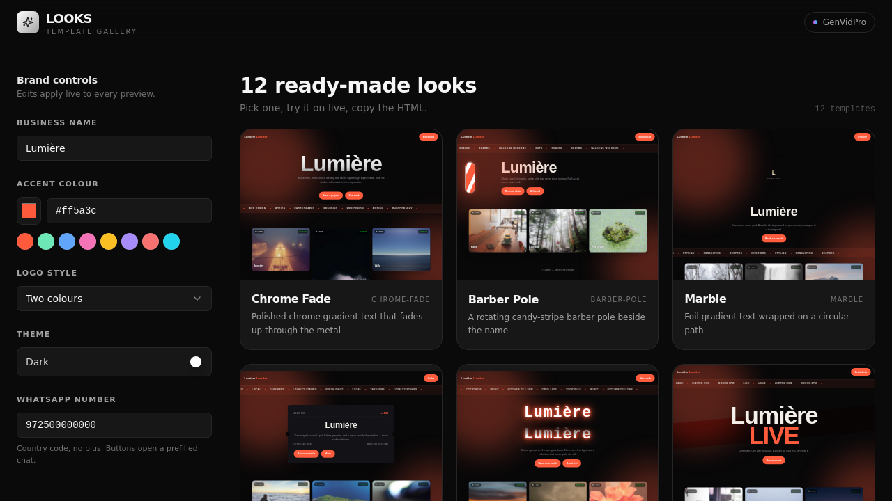

# LOOKS

**An interactive gallery where a small business types in its name, picks a colour, and sees twelve high-motion website templates wearing its brand — live.**

🔗 **Live demo:** https://looks-live-site.base44.app

## What it does

Showing a client static mockups means asking them to imagine their own name on it. LOOKS removes the imagining: business name, accent colour, logo style, light/dark and WhatsApp number are five controls on the left, and all twelve templates in the grid re-render with them as you type.

Each template is a complete, self-contained HTML document generated in the browser. Open one full size, then copy the HTML or open it in a new tab — what you see is the whole deliverable, not a screenshot of one.

## Features

- **Live brand controls** — name, accent colour (picker plus swatches), four logo treatments, dark/light, WhatsApp number. Changes propagate to every tile at once, deferred so typing stays smooth.
- **Twelve templates**, each built around one motion idea: Chrome Fade, Barber Pole, Marble, Corner Shop, Night Shift, Poster, Zine, The Column, Walk In, Bands, Terminal, Old Sign.
- **Real previews** — every tile is a sandboxed iframe running the actual generated document, scaled to fit.
- **Shared motion kit** — film grain, drifting auras, scroll reveals, Ken Burns photo cards and marquees, composed by every template so the gallery moves as one system.
- **Take it with you** — copy the generated HTML to the clipboard or open the full document in a new tab.
- **WhatsApp wired in** — every call to action in every template opens a prefilled chat with the number you entered.

## Stack

Built on **Base44**: React + Vite frontend, Base44 auth, hosted on Base44. Templates are plain JavaScript modules returning a full HTML string (`src/lib/templates/`), composed from a shared kit; app UI is Tailwind CSS with shadcn/ui primitives. No entities — nothing is stored, everything is generated client-side.

## How this is built

Idea, product decisions and creative direction by Roma Chorny (GenVidPro). Built on Base44 with Claude.

## Notes on this repository

- This is the app's source as exported from the Base44 platform API. Local setup and publishing instructions are in [`README.base44.md`](README.base44.md).
- `src/components/ui/` holds only the shadcn/ui primitives this app actually imports — Base44 scaffolds the full set into every app, and the unused ones are left out to keep the repo readable.
- Preview photography uses `picsum.photos` placeholders.
